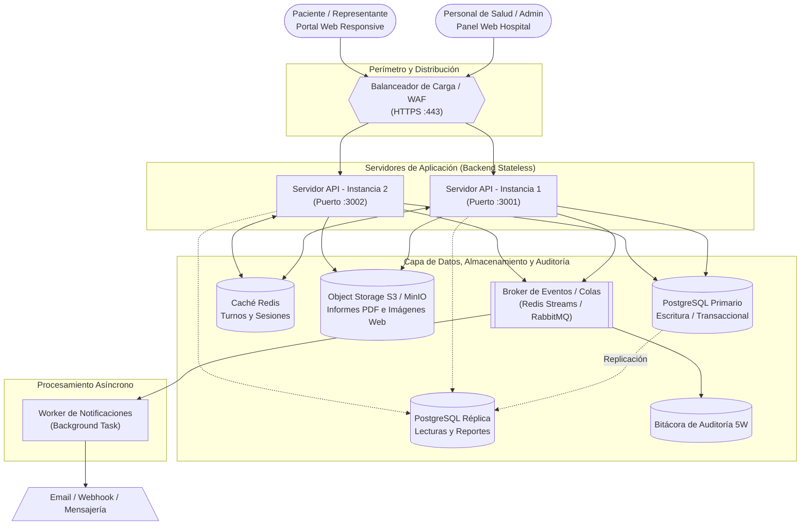

# Arquitectura Inicial del Sistema

El siguiente diagrama representa la arquitectura de alto nivel de la solución (Modelo C4 - Nivel 2: Contenedores). 
El flujo parte de dos puntos de acceso web adaptables, pasando por un balanceador de carga hacia múltiples instancias del servidor de aplicación (*backend stateless*). Los datos se almacenan de manera segregada según su naturaleza y se utilizan colas de mensajería para desacoplar el procesamiento asíncrono.

## Diagrama de la Arquitectura Inicial

