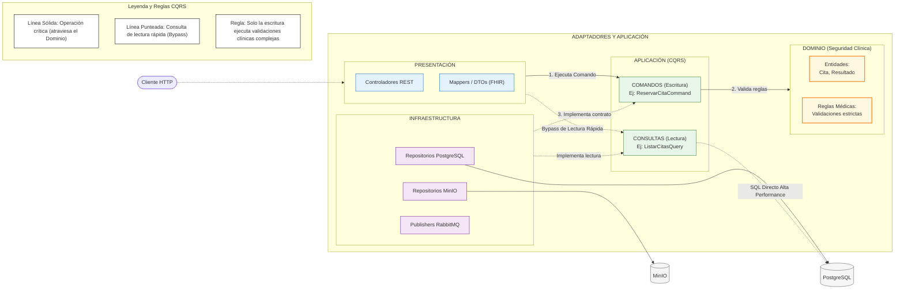

# Enfoque Arquitectónico

**Enfoque Seleccionado:** Clean Architecture (Arquitectura Limpia) complementado con el patrón CQRS (Separación de Responsabilidades de Comandos y Consultas).

## Descripción Arquitectónica
A nivel micro, la estructura interna del código obedece a la "Regla de Dependencia Inversa". El sistema se organiza en capas concéntricas donde el **Dominio** (que contiene las entidades y estrictas reglas clínicas) reside en el centro, totalmente agnóstico a la tecnología externa. 

Para resolver el problema del exceso de procesamiento (*sobreingeniería*) en operaciones sencillas, se ha integrado el patrón **CQRS**. El flujo de la aplicación se bifurca en dos caminos:
* **Comandos (Escritura):** Operaciones críticas (ej. *Reservar Cita* o *Publicar Diagnóstico*) atraviesan estrictamente la barrera del Dominio para ser validadas por las reglas médicas.
* **Consultas (Lectura):** Operaciones de alto volumen (ej. *Listar Especialidades*) realizan un *bypass* del Dominio, leyendo directamente desde la infraestructura para maximizar el rendimiento.

## Justificación Técnica
1. **Seguridad Clínica (Clinical Safety):** Aislar las reglas médicas en el núcleo asegura que vulnerabilidades o cambios en tecnologías externas (como una actualización del framework Express, o el cambio de almacenamiento a AWS S3) jamás alteren la integridad lógica de un diagnóstico validado.
2. **Interoperabilidad Estándar:** La capa de Adaptadores actúa como una barrera anticorrupción, permitiendo utilizar mapeadores (DTOs) para traducir la información interna a estándares mundiales de salud (como HL7 FHIR), preparando al hospital para integraciones gubernamentales (MINSA/SIS).
3. **Rendimiento Optimizado:** La inclusión de CQRS permite que el sistema entregue vistas de lectura en milisegundos, reservando el procesamiento pesado únicamente para cuando el usuario realiza una modificación real de los datos.

## Diagrama del Enfoque Arquitectónico

