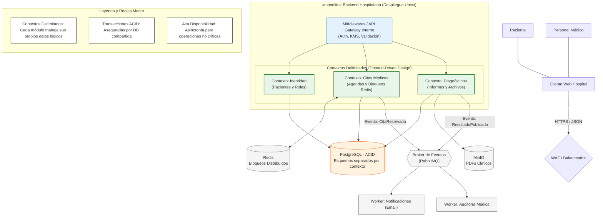

# Estilo Arquitectónico

**Estilo Seleccionado:** Monolito Modular Orientado a Eventos (basado en *Domain-Driven Design*).

## Descripción Arquitectónica
La arquitectura a nivel macro se ha diseñado bajo un modelo de despliegue centralizado (*backend stateless*) escalable horizontalmente a través de un Balanceador de Carga (WAF). Para gestionar la complejidad del sector salud sin comprometer la consistencia de los datos, el sistema rechaza la fragmentación extrema de los microservicios y opta por **Contextos Delimitados (Bounded Contexts)**. Internamente, el código opera en módulos lógicos estrictamente aislados (Identidad, Citas Médicas, Diagnósticos), pero que comparten una única base de datos transaccional.

Adicionalmente, se integra un diseño **Orientado a Eventos** mediante un Message Broker (RabbitMQ), aislando los procesos principales de las tareas secundarias (como el envío de notificaciones y el registro de auditoría), garantizando así una alta disponibilidad.

## Justificación Técnica
1. **Consistencia ACID Crítica:** En un entorno hospitalario, la pérdida de sincronización de datos es un riesgo clínico inaceptable. Al centralizar la persistencia en PostgreSQL (apoyado por índices *EXCLUDE* y *WAL Archiving*), se garantiza la atomicidad de operaciones críticas, como evitar el cruce de horarios en citas médicas (*double-booking*).
2. **Resiliencia y Rendimiento:** La integración de Redis absorbe la carga de control de concurrencia temporal, mientras que RabbitMQ expulsa del hilo principal las tareas propensas a fallos por red (ej. envío de SMS/Emails), asegurando que el paciente siempre reciba una respuesta rápida.

## Diagrama del Estilo Arquitectónico

