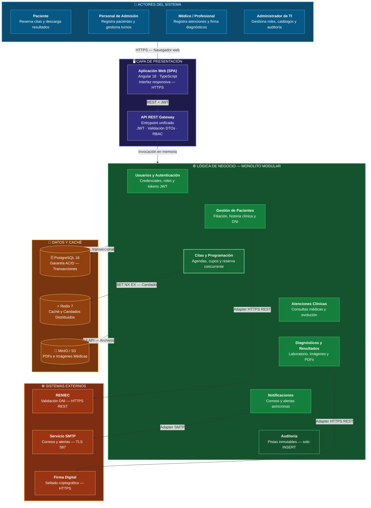

# Arquitectura inicial del sistema HRA

## Diagrama de arquitectura

<!-- imagen #01 — Arquitectura Inicial General del Sistema HRA -->

## Descripción

La arquitectura inicial del sistema HRA (Hospital Regional Docente de Las Mercedes) se organiza en cuatro capas y límites de integración bien definidos:

- **Presentación:** Gestiona la interacción de los usuarios mediante una aplicación web de una sola página (SPA) responsiva y accesible desde navegadores móviles o de escritorio. Toda comunicación se canaliza hacia una API REST centralizada que autentica peticiones y valida datos de entrada.
- **Lógica de negocio:** Organizada bajo un enfoque de **monolito modular**. Cada módulo encapsula un dominio funcional del hospital:
  - *Usuarios y Autenticación:* Gestión de credenciales, roles y sesiones JWT.
  - *Gestión de Pacientes:* Registro, filiación y validación de identidad.
  - *Citas y Programación:* Gestión de agendas médicas, disponibilidad de turnos, reserva concurrente y reprogramación.
  - *Atenciones Clínicas:* Registro de consultas médicas y evolución clínica.
  - *Diagnósticos y Resultados:* Emisión y consulta de órdenes de laboratorio e imágenes médicas.
  - *Notificaciones:* Despacho asíncrono de recordatorios y avisos clínicos.
  - *Auditoría y Trazabilidad:* Registro inmutable de operaciones sensibles para cumplimiento normativo de salud.
- **Datos y Almacenamiento:** 
  - *Base de datos relacional (PostgreSQL):* Garantiza consistencia transaccional ACID para historias clínicas, citas y datos de filiación.
  - *Caché en memoria (Redis):* Almacena agendas y catálogos de alta frecuencia de lectura para optimizar tiempos de respuesta (< 1.5s).
  - *Almacenamiento de objetos (MinIO / S3):* Guarda de forma segura archivos pesados (informes en PDF y resultados de laboratorio escaneados).
- **Integraciones externas:**
  - *RENIEC:* Valida la autenticidad del Documento Nacional de Identidad en el registro.
  - *Servicio de Notificaciones:* Envío de correos y alertas de citas.
  - *Servicio de Firma / Sellado Digital:* Firma digital de reportes médicos diagnósticos.
