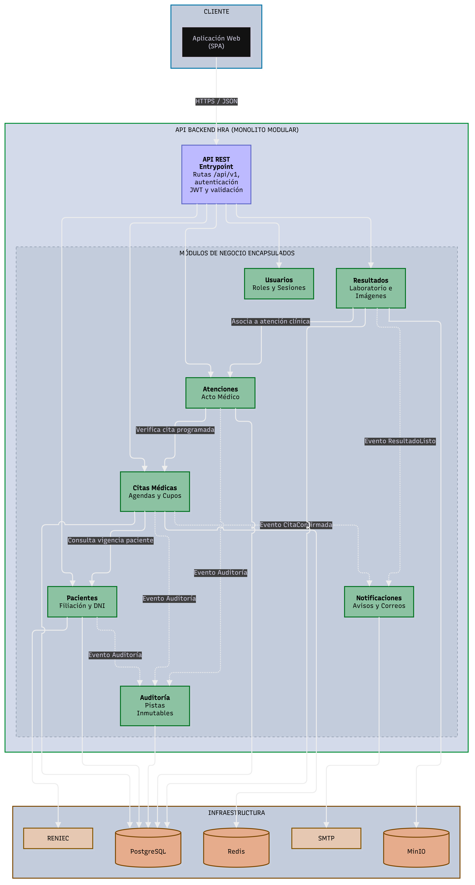

# Componentes arquitectónicos

## Módulos del monolito modular

| Componente | Responsabilidad | Funcionalidades principales | Paquete en el código |
|---|---|---|---|
| **API REST** | Punto de entrada HTTP del backend | Rutas `/api/v1`, autenticación JWT, validación de entrada, manejo de errores | `api/` |
| **Identidad y acceso** | Autenticación, roles y permisos | Registro y activación de pacientes, inicio de sesión, roles (paciente, admisión, laboratorio, imágenes, validador, médico, administrador, auditor), representación autorizada | `modules/identidad/` |
| **Citas médicas** | Programación de atenciones | Consulta de disponibilidad, reserva con prevención de doble asignación, reprogramación, cancelación | `modules/citas/` |
| **Laboratorio** | Resultados de análisis clínicos | Registro de solicitudes y resultados, asociación de informes PDF, envío a validación | `modules/laboratorio/` |
| **Diagnóstico por imágenes** | Estudios de imagen | Registro de radiografía, ecografía y tomografía, informes PDF e imágenes representativas, envío a validación | `modules/imagenes/` |
| **Notificaciones** | Comunicación con el paciente | Confirmación de citas, aviso de disponibilidad de resultados, reintentos ante falla del servicio de correo | `modules/notificaciones/` |
| **Auditoría** | Trazabilidad | Registro de accesos, modificaciones sobre citas e informes, consulta de trazas | `modules/auditoria/` |
| **Administración** | Configuración de la plataforma | Gestión de profesionales, especialidades, horarios, cuentas de usuario y permisos | `modules/administracion/` |

## Reglas del monolito modular

| # | Regla | Motivo |
|---|---|---|
| 1 | Todos los módulos se despliegan juntos en el backend | Es un monolito: un solo proceso y un solo despliegue. |
| 2 | Un módulo usa a otro solo a través de su API pública | Evita que un cambio interno en un módulo rompa a los demás. Spring Modulith verifica esto. |
| 3 | Un módulo no lee ni escribe las tablas de otro módulo | Mantiene la independencia de datos de cada módulo. |
| 4 | Cada sistema externo se integra en un único módulo | La integración queda en un solo lugar y es fácil de reemplazar. |
| 5 | Cada módulo se organiza por dentro con Clean Architecture | Las reglas de negocio no dependen de la tecnología. |
## Diagrama de componentes

