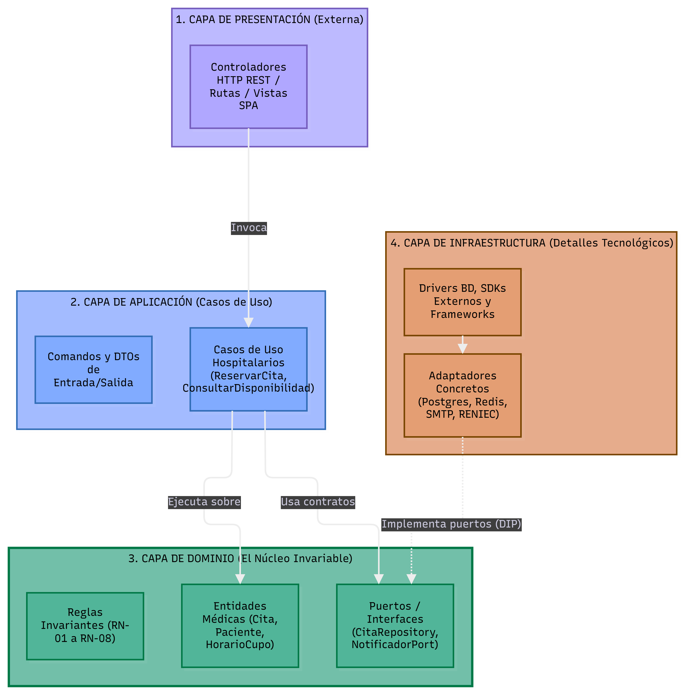

# Enfoque arquitectónico: Clean Architecture

| Elemento | Descripción aplicada al sistema HRA |
|---|---|
| Patrón / enfoque arquitectónico | Clean Architecture (Arquitectura Limpia). |
| Objetivo | Separar responsabilidades y controlar las dependencias hacia el dominio. |
| ¿Qué problema resuelve? | Evita el acoplamiento entre la interfaz React, las reglas del negocio y las tecnologías externas como Spring Boot, PostgreSQL, Redis y servicios de almacenamiento S3. |
| Capas definidas | Dominio, Aplicación, Infraestructura y Presentación. |
| Beneficios | • Facilita el mantenimiento y las pruebas unitarias. • Permite cambiar implementaciones técnicas (BD, almacenamiento, correo) sin modificar las reglas del negocio. • Mejora la organización y separación de responsabilidades del código. • Las pruebas del dominio y aplicación corren sin Spring, sin BD y sin servicios externos. |

## Capas dentro de cada módulo

| Capa | Contiene | Responsabilidad | Puede depender de | **No** puede depender de |
|---|---|---|---|---|
| **Dominio** | Entidades, objetos de valor, enumeraciones, interfaces (puertos/contratos) | Reglas de negocio que serían ciertas con cualquier tecnología | Nada externo | Aplicación, infraestructura, presentación, Spring, JPA, SDK |
| **Aplicación** | Casos de uso, comandos, DTOs de entrada | Orquestar el flujo: qué paso va primero y qué hacer si falla | Dominio | Infraestructura, presentación, Spring, JPA |
| **Infraestructura** | Repositorios concretos, adaptadores de servicios externos | Implementar las interfaces del dominio con una tecnología concreta | Dominio, librerías externas (JPA, S3 SDK, Mail) | Aplicación, presentación |
| **Presentación** | Controladores REST, DTOs de respuesta | Traducir HTTP a llamadas del caso de uso y viceversa | Aplicación | Infraestructura, base de datos |
| **Composición** | Configuración Spring del módulo | Elegir implementaciones concretas e inyectarlas | Todas | — |

## Regla de dependencia

## Diagrama del enfoque arquitectónico

