# Enfoque arquitectónico: Clean Architecture

| Elemento | Descripción aplicada al sistema HRA |
|---|---|
| Patrón / enfoque arquitectónico | Clean Architecture (Arquitectura Limpia). |
| Objetivo | Separar responsabilidades y controlar las dependencias hacia el dominio. |
| ¿Qué problema resuelve? | Evita el acoplamiento entre la interfaz React, las reglas del negocio y las tecnologías externas como Spring Boot, PostgreSQL, Redis y servicios de almacenamiento S3. |
| Capas definidas | Dominio, Aplicación, Infraestructura y Presentación. |
| Beneficios | • Facilita el mantenimiento y las pruebas unitarias. • Permite cambiar implementaciones técnicas (BD, almacenamiento, correo) sin modificar las reglas del negocio. • Mejora la organización y separación de responsabilidades del código. • Las pruebas del dominio y aplicación corren sin Spring, sin BD y sin servicios externos. |

## Capas dentro de cada módulo

| Capa | Contiene | Responsabilidad | Puede depender de | **No** puede depender de |
|---|---|---|---|---|
| **Dominio** | Entidades, objetos de valor, enumeraciones, interfaces (puertos/contratos) | Reglas de negocio que serían ciertas con cualquier tecnología | Nada externo | Aplicación, infraestructura, presentación, Spring, JPA, SDK |
| **Aplicación** | Casos de uso, comandos, DTOs de entrada | Orquestar el flujo: qué paso va primero y qué hacer si falla | Dominio | Infraestructura, presentación, Spring, JPA |
| **Infraestructura** | Repositorios concretos, adaptadores de servicios externos | Implementar las interfaces del dominio con una tecnología concreta | Dominio, librerías externas (JPA, S3 SDK, Mail) | Aplicación, presentación |
| **Presentación** | Controladores REST, DTOs de respuesta | Traducir HTTP a llamadas del caso de uso y viceversa | Aplicación | Infraestructura, base de datos |
| **Composición** | Configuración Spring del módulo | Elegir implementaciones concretas e inyectarlas | Todas | — |

## Regla de dependencia

> **La regla de dependencia:** El flujo de control y las dependencias del código solo pueden apuntar hacia adentro (**Dominio**). Las capas externas (Controladores, Bases de Datos, Adaptadores externos) dependen de las abstracciones del centro. El núcleo de salud no conoce frameworks, JPA, Express ni drivers de persistencia.

## Diagrama del enfoque arquitectónico: Clean Architecture en Capas

```mermaid
flowchart TD

%% ==========================================
%% 1. CAPA DE PRESENTACIÓN (EXTERNAL / ADAPTERS)
%% ==========================================
subgraph PRESENTACION["1. CAPA DE PRESENTACIÓN (Controladores HTTP REST y Vistas)"]
    direction TB
    CtrlCita["<b>CitaController</b><br>Ruta POST /api/v1/citas"]
    CtrlPac["<b>PacienteController</b><br>Ruta GET /api/v1/pacientes"]
    CtrlDiag["<b>DiagnosticoController</b><br>Ruta GET /api/v1/resultados"]
    DTOs_In["<b>DTOs de Entrada y Serializadores</b><br>Validación de esquemas JSON y tipos"]
    Guards["<b>Filtros de Seguridad</b><br>JWT Bearer y validación de Roles RBAC"]
end

%% ==========================================
%% 2. CAPA DE APLICACIÓN (APPLICATION BUSINESS RULES)
%% ==========================================
subgraph APLICACION["2. CAPA DE APLICACIÓN (Casos de Uso del Hospital)"]
    direction TB
    UC_Reservar["<b>ReservarCitaUseCase</b><br>Orquesta candado, verificación y persistencia"]
    UC_Disp["<b>ConsultarDisponibilidadUseCase</b><br>Consulta turnos médicos libres"]
    UC_ValDiag["<b>ValidarResultadoUseCase</b><br>Aprobación médica de análisis clínicos"]
    UC_Canc["<b>CancelarCitaUseCase</b><br>Liberación de cupos y aviso al paciente"]
    Cmds["<b>Comandos y Consultas DTO</b><br>ReservarCitaCommand · ConsultarTurnosQuery"]
end

%% ==========================================
%% 3. CAPA DE DOMINIO (ENTERPRISE BUSINESS RULES - NÚCLEO PURO)
%% ==========================================
subgraph DOMINIO["3. CAPA DE DOMINIO (El Núcleo Invariable de Salud)"]
    direction TB
    
    subgraph DOM_ENTIDADES["Entidades y Objetos de Valor (Lógica Pura)"]
        EntCita["<b>Entidad Cita</b><br>Reglas de estado y asignación"]
        EntPac["<b>Entidad Paciente</b><br>Filiación e Historia Clínica"]
        VO_Horario["<b>VO HorarioCupo</b><br>Médico, fecha y unicidad de turno"]
        ReglasNeg["<b>Reglas Invariantes de Salud</b><br>RN-01 a RN-08 (Unicidad y Auditoría)"]
    end

    subgraph DOM_PUERTOS["Puertos del Dominio (Contratos / Interfaces)"]
        PortRepo["<b>CitaRepository</b><br>Contrato de persistencia"]
        PortLock["<b>BloqueoCupoPort</b><br>Contrato de candado distribuido"]
        PortNotif["<b>NotificadorPort</b><br>Contrato de alertas al paciente"]
        PortFirma["<b>FirmaDigitalPort</b><br>Contrato de sellado de informes"]
    end
end

%% ==========================================
%% 4. CAPA DE INFRAESTRUCTURA (FRAMEWORKS & DRIVERS)
%% ==========================================
subgraph INFRAESTRUCTURA["4. CAPA DE INFRAESTRUCTURA (Adaptadores y Tecnologías Concretas)"]
    direction TB
    AdapPostgres["<b>PostgresCitaRepository</b><br>Implementa CitaRepository via SQL"]
    AdapRedis["<b>RedisBloqueoAdapter</b><br>Implementa BloqueoCupoPort con SET NX EX"]
    AdapSMTP["<b>SmtpNotificadorAdapter</b><br>Implementa NotificadorPort via Mailer"]
    AdapS3["<b>MinIOStorageAdapter</b><br>Implementa almacenamiento de PDFs médicos"]
    AdapReniec["<b>ReniecRestAdapter</b><br>Integración HTTP con validación de DNI"]
end

%% ==========================================
%% RELACIONES Y FLUJO DE CONTROL
%% ==========================================
%% Presentación a Aplicación
CtrlCita -->|Instancia y envía| Cmds
Cmds -->|Procesado por| UC_Reservar
CtrlPac -->|Invoca caso de uso| UC_Disp
CtrlDiag -->|Invoca caso de uso| UC_ValDiag

%% Aplicación a Dominio
UC_Reservar -->|Ejecuta lógica sobre| EntCita
UC_Reservar -->|Valida contra| VO_Horario
UC_Reservar -->|Usa contrato| PortRepo
UC_Reservar -->|Usa contrato| PortLock
UC_Reservar -->|Usa contrato| PortNotif

%% Inversión de Dependencias (DIP): Infraestructura implementa Puertos
AdapPostgres -.->|Implementa interfaz DIP| PortRepo
AdapRedis -.->|Implementa interfaz DIP| PortLock
AdapSMTP -.->|Implementa interfaz DIP| PortNotif
AdapS3 -.->|Implementa interfaz DIP| PortFirma

%% ==========================================
%% ESTILOS VISUALES
%% ==========================================
style PRESENTACION fill:#1e1b4b,stroke:#818cf8,stroke-width:2px,color:#fff
style APLICACION fill:#172554,stroke:#60a5fa,stroke-width:2px,color:#fff
style DOMINIO fill:#064e3b,stroke:#34d399,stroke-width:3px,color:#fff
style INFRAESTRUCTURA fill:#451a03,stroke:#fbbf24,stroke-width:2px,color:#fff

style DOM_ENTIDADES fill:#065f46,stroke:#10b981,stroke-width:1.5px,color:#fff
style DOM_PUERTOS fill:#047857,stroke:#6ee7b7,stroke-width:1.5px,stroke-dasharray: 4 4,color:#fff

style CtrlCita fill:#312e81,stroke:#a5b4fc,color:#fff
style CtrlPac fill:#312e81,stroke:#a5b4fc,color:#fff
style CtrlDiag fill:#312e81,stroke:#a5b4fc,color:#fff
style DTOs_In fill:#312e81,stroke:#a5b4fc,color:#fff
style Guards fill:#312e81,stroke:#a5b4fc,color:#fff

style UC_Reservar fill:#1e40af,stroke:#93c5fd,color:#fff
style UC_Disp fill:#1e40af,stroke:#93c5fd,color:#fff
style UC_ValDiag fill:#1e40af,stroke:#93c5fd,color:#fff
style UC_Canc fill:#1e40af,stroke:#93c5fd,color:#fff
style Cmds fill:#1e40af,stroke:#93c5fd,color:#fff

style EntCita fill:#047857,stroke:#6ee7b7,color:#fff
style EntPac fill:#047857,stroke:#6ee7b7,color:#fff
style VO_Horario fill:#047857,stroke:#6ee7b7,color:#fff
style ReglasNeg fill:#047857,stroke:#6ee7b7,color:#fff

style PortRepo fill:#065f46,stroke:#a7f3d0,color:#fff
style PortLock fill:#065f46,stroke:#a7f3d0,color:#fff
style PortNotif fill:#065f46,stroke:#a7f3d0,color:#fff
style PortFirma fill:#065f46,stroke:#a7f3d0,color:#fff

style AdapPostgres fill:#78350f,stroke:#fde68a,color:#fff
style AdapRedis fill:#78350f,stroke:#fde68a,color:#fff
style AdapSMTP fill:#78350f,stroke:#fde68a,color:#fff
style AdapS3 fill:#78350f,stroke:#fde68a,color:#fff
style AdapReniec fill:#78350f,stroke:#fde68a,color:#fff
```

<!-- imagen #03 — Enfoque Arquitectónico: Clean Architecture con DIP -->

### Explicación del flujo y relaciones del diagrama

1. **Flujo de Entrada (Presentación → Aplicación):**
   - El cliente web envía una petición HTTP (`POST /api/v1/citas`).
   - El controlador `CitaController` extrae la identidad del paciente del token JWT y construye el comando tipado `ReservarCitaCommand`.
   - Se invoca el caso de uso `ReservarCitaUseCase`. La capa de presentación **solo conoce a la capa de aplicación**.

2. **Orquestación de Negocio (Aplicación → Dominio):**
   - El caso de uso coordina la transacción invocando la entidad `Cita` y el objeto de valor `HorarioCupo` para validar las reglas invariantes (por ejemplo, que la fecha sea futura y el cupo válido).
   - Para interactuar con el mundo exterior (base de datos, caché Redis, notificaciones por correo), la aplicación utiliza **únicamente los Puertos** (`CitaRepository`, `BloqueoCupoPort`, `NotificadorPort`).
   - La capa de aplicación **no conoce ninguna librería ni tecnología externa**.

3. **Inversión de Dependencias (Infraestructura → Dominio):**
   - Las flechas punteadas (`-.->`) representan la **Inversión de Dependencias (DIP)**: las clases concretas de la infraestructura (`PostgresCitaRepository`, `RedisBloqueoAdapter`, `SmtpNotificadorAdapter`) implementan las interfaces declaradas en el Dominio.
   - Si se decide reemplazar PostgreSQL por otra base de datos o cambiar el proveedor de correo SMTP por una API de WhatsApp, **el Dominio y los Casos de Uso permanecen 100% inalterados**.
