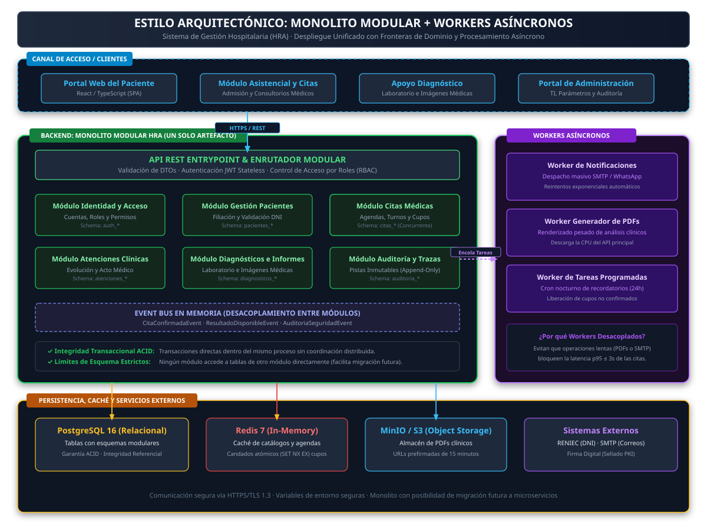
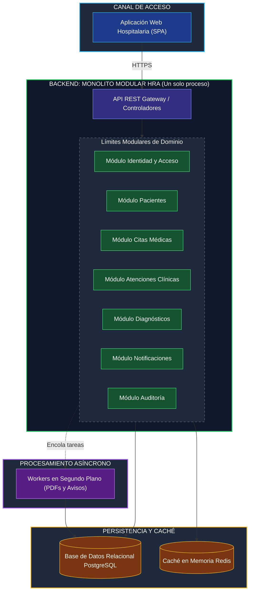

# Estilo arquitectónico

Se utiliza el estilo arquitectónico: **monolito modular + workers**.

| Elemento | Descripción aplicada al sistema HRA |
|---|---|
| Estilo arquitectónico | Monolito modular con workers para procesamiento asíncrono. |
| Objetivo | Mantener integridad transaccional simple y facilitar el desarrollo y evolución controlada del sistema. |
| ¿Qué problema resuelve? | Evita la complejidad operativa de microservicios (red, consistencia distribuida, monitoreo) manteniendo la capacidad de evolucionar módulos de forma independiente. |
| Módulos definidos | Identidad y acceso, Citas médicas, Laboratorio, Diagnóstico por imágenes, Notificaciones, Auditoría, Administración, Portal del paciente. |
| Beneficios | • Transacciones ACID directas sin coordinación distribuida. • Operación y despliegue simples. • Los módulos permiten separar a microservicios en el futuro si es necesario. • Workers desacoplan tareas asíncronas sin comprometer las operaciones principales. |

| Alternativa evaluada | Ventajas | Costos y riesgos | Motivo de descarte |
|---|---|---|---|
| Microservicios | Escalamiento y despliegue independientes. | Mayor complejidad de red, monitoreo, consistencia y operación. | Equipo pequeño, plazo acotado, volumen de 1 000 usuarios no lo justifica. |
| Monolito sin modularizar | Desarrollo inicial rápido. | Acoplamiento creciente, difícil de mantener y evolucionar. | No cumple DA06 – Mantenibilidad. |

## Diagrama del estilo arquitectónico: Monolito modular con workers

