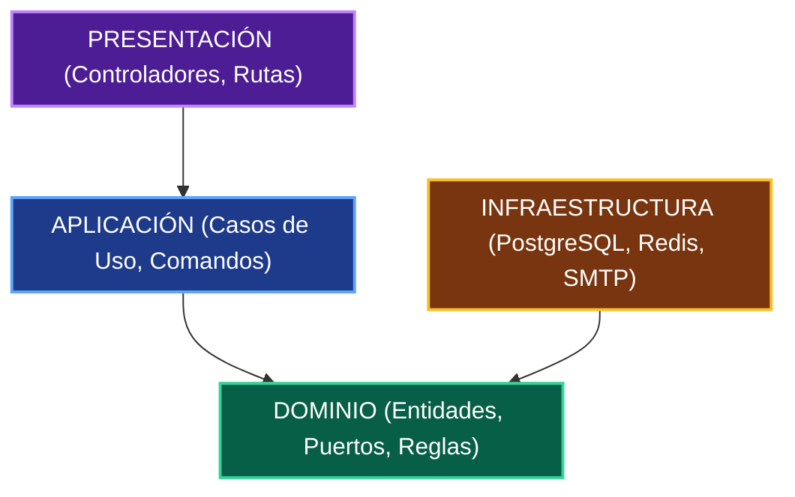
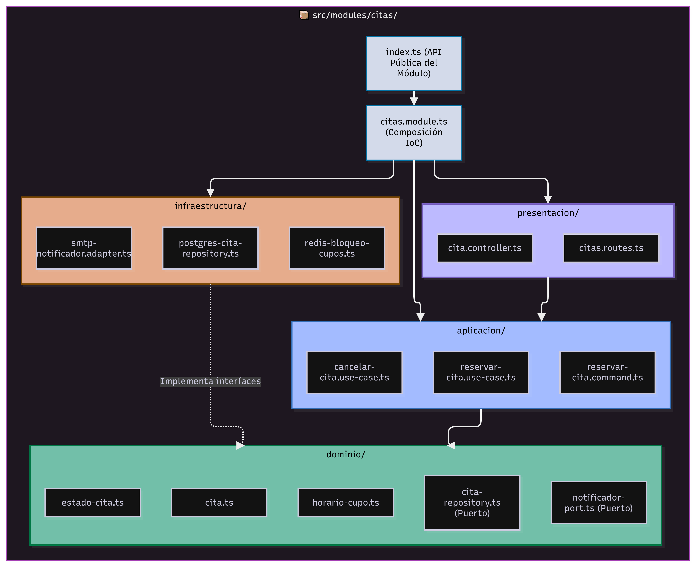
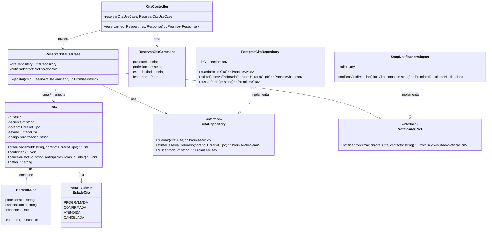
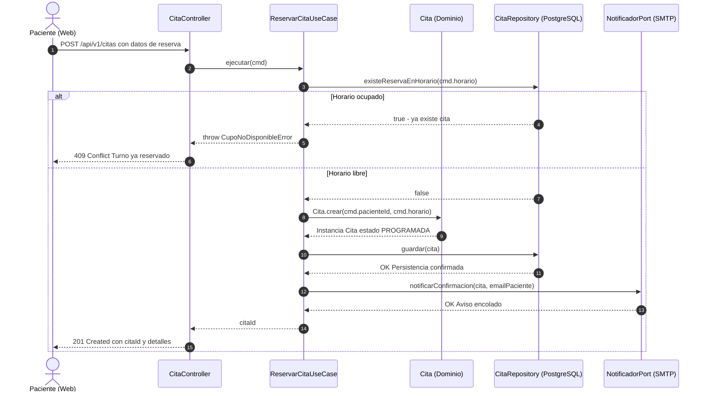

# Diseño interno de módulos

> **Proyecto:** Sistema de Gestión Hospitalaria (HRA) · **Backend:** TypeScript / Node.js (o Java / Spring Boot) · **Módulo de referencia:** Citas Médicas  
> **Enfoque arquitectónico:** Clean Architecture dentro de cada módulo del monolito modular  
> **Nivel C4:** 4 – Código · **Versión:** 1.0

---

## 1. Propósito

Este documento describe **cómo se organiza el código dentro de un módulo** del backend del sistema HRA. Tiene tres objetivos fundamentales:

- Que todos los módulos del sistema hospitalario (Pacientes, Citas, Atenciones, Diagnósticos, etc.) se construyan con la misma estructura y convención.
- Que las reglas de negocio médico y gestión de cupos queden estrictamente aisladas de la tecnología y proveedores externos.
- Que cualquier integrante del equipo de desarrollo sepa exactamente dónde ubicar cada archivo y qué dependencias tiene permitido importar.

---

## 2. Estructura de carpetas

A continuación se muestra la estructura del módulo de referencia **Citas**:

```text
src/
└── modules/
    └── citas/
        ├── dominio/
        │   ├── cita.ts                       Entidad Cita con reglas de validación y estados
        │   ├── horario-cupo.ts               Objeto de valor HorarioCupo (médico, fecha, hora)
        │   ├── estado-cita.ts                Enumeración EstadoCita (PROGRAMADA, CONFIRMADA, etc.)
        │   ├── cita-repository.ts            Interfaz (puerto) de persistencia de citas
        │   ├── notificador-port.ts           Interfaz (puerto) para notificar al paciente
        │   └── resultado-notificacion.ts     DTO de confirmación del envío de notificación
        ├── aplicacion/
        │   ├── reservar-cita.use-case.ts     Caso de uso ReservarCita
        │   ├── reservar-cita.command.ts      DTO de entrada validado para reservar cita
        │   └── cancelar-cita.use-case.ts     Caso de uso CancelarCita
        ├── infraestructura/
        │   ├── postgres-cita-repository.ts   Implementación del repositorio con PostgreSQL/TypeORM
        │   ├── redis-bloqueo-cupos.ts        Manejo de bloqueo concurrente de cupos en Redis
        │   └── smtp-notificador.adapter.ts   Implementación de notificación por correo/SMTP
        ├── presentacion/
        │   ├── cita.controller.ts            Manejador HTTP (traduce HTTP ⇄ Casos de Uso)
        │   └── citas.routes.ts               Rutas expuestas `/api/v1/citas`
        ├── citas.module.ts                   Contenedor de inyección de dependencias del módulo
        └── index.ts                          API pública expuesta para otros módulos del monolito
```

### Responsabilidades por archivo

| Archivo | Capa | Responsabilidad | Importa de |
|---|---|---|---|
| `cita.ts` | Dominio | Crear citas válidas, controlar transiciones de estado, validar cancelaciones (RN-01 a RN-04) | Solo dominio |
| `horario-cupo.ts` | Dominio | Representar de forma inmutable el profesional, especialidad, fecha y franja horaria | Nada |
| `estado-cita.ts` | Dominio | Definir los estados válidos: `PROGRAMADA`, `CONFIRMADA`, `ATENDIDA`, `CANCELADA` | Nada |
| `cita-repository.ts` | Dominio | Declarar el contrato de persistencia para guardar, buscar y validar disponibilidad | `cita.ts`, `horario-cupo.ts` |
| `notificador-port.ts` | Dominio | Declarar el contrato de mensajería para avisar al paciente | `resultado-notificacion.ts` |
| `reservar-cita.use-case.ts` | Aplicación | Coordinar la reserva: verificar disponibilidad, crear cita, persistir y solicitar notificación | Dominio |
| `reservar-cita.command.ts` | Aplicación | DTO con los datos de entrada limpios requeridos para la reserva | Nada |
| `postgres-cita-repository.ts` | Infraestructura | Implementar consultas SQL transaccionales en PostgreSQL | Dominio + driver de BD / ORM |
| `redis-bloqueo-cupos.ts` | Infraestructura | Garantizar exclusión mutua para evitar sobreventa de cupos concurrentes | Dominio + cliente Redis |
| `smtp-notificador.adapter.ts` | Infraestructura | Traducir llamadas del dominio al protocolo SMTP / proveedor de correos | Dominio + cliente de correo |
| `cita.controller.ts` | Presentación | Recibir peticiones HTTP, parsear payload, invocar el caso de uso y formatear códigos de estado | Aplicación |
| `citas.routes.ts` | Presentación | Declarar middlewares de seguridad JWT y registrar rutas en el router web | Presentación |
| `citas.module.ts` | Composición | Ensamblar adaptadores con casos de uso e inyectar dependencias | Todas las capas |
| `index.ts` | Composición | Exponer únicamente los servicios permitidos para consumo de otros módulos | `citas.module.ts` |

---

## 3. Capas del módulo y regla de dependencia





> **Regla de dependencia:** El código solo puede importar hacia el centro (**Dominio**). El dominio no conoce bibliotecas HTTP, bases de datos ni servicios de correo externos.

| Capa | Contiene | Responsabilidad | Puede depender de | **No** puede depender de |
|---|---|---|---|---|
| **Dominio** | Entidades, objetos de valor, enumeraciones, interfaces (puertos) | Reglas del negocio de salud invariantes e independientes de cualquier tecnología | Nada externo | Aplicación, infraestructura, presentación, Express, TypeORM, Redis, SMTP |
| **Aplicación** | Casos de uso, comandos | Orquestar el flujo: validaciones de flujo, coordinación de repositorios y servicios | Dominio | Infraestructura, presentación, frameworks web |
| **Infraestructura** | Repositorios concretos, adaptadores externos, clientes caché | Implementar las interfaces del dominio con tecnologías concretas | Dominio, librerías externas | Aplicación, presentación |
| **Presentación** | Controladores, rutas | Traducir HTTP a comandos de aplicación y devolver códigos HTTP estándar | Aplicación | Infraestructura, base de datos |
| **Composición** | `citas.module.ts` | Instanciar adaptadores y casos de uso enlazando las dependencias | Todas las capas | — |

---

## 4. Diagrama de clases del módulo Citas




### 4.1 Notación UML utilizada

| Símbolo | Significado | Ejemplo en el diagrama |
|---|---|---|
| Línea continua con flecha abierta (`-->`) | Asociación: una clase retiene referencia hacia otra | `ReservarCitaUseCase` → `CitaRepository` |
| Línea discontinua con flecha abierta (`..>`) | Dependencia: una clase crea o recibe como parámetro | `CitaController` ..> `ReservarCitaCommand` |
| Línea discontinua con triángulo hueco (`..|>`) | Realización: una clase implementa una interfaz | `PostgresCitaRepository` ..|> `CitaRepository` |
| Rombo relleno (`*--`) | Composición: ciclo de vida acoplado | `Cita` *-- `HorarioCupo` |
| `<<interface>>` | Interfaz (puerto sin implementación tecnológica) | `CitaRepository`, `NotificadorPort` |
| `-` / `+` | Visibilidad privada / pública | `- estado`, `+ confirmar()` |

---

## 5. Flujo de ejecución: reservar cita




| Paso | Origen → Destino | Acción | Capa |
|---|---|---|---|
| 1 | Paciente Web → `CitaController` | Solicitud `POST /api/v1/citas` con token JWT y datos de reserva | Presentación |
| 2 | `CitaController` → `ReservarCitaUseCase` | Instancia comando y ejecuta `ejecutar(cmd)` | Presentación → Aplicación |
| 3 | `ReservarCitaUseCase` → `CitaRepository` | Invoca `existeReservaEnHorario(cmd.horario)` para verificar vacante | Aplicación → Dominio (interfaz) |
| 4 | `ReservarCitaUseCase` → `Cita` | Invoca `Cita.crear(pacienteId, horario)`; evalúa reglas de negocio | Aplicación → Dominio |
| 5 | `ReservarCitaUseCase` → `CitaRepository` | Invoca `guardar(cita)` para persistir en base de datos relacional | Aplicación → Dominio (interfaz) |
| 6 | `PostgresCitaRepository` → PostgreSQL | Ejecuta transacción `INSERT INTO citas ...` | Infraestructura → BD |
| 7 | `ReservarCitaUseCase` → `NotificadorPort` | Solicita envío de confirmación de reserva al paciente | Aplicación → Dominio (interfaz) |
| 8 | `SmtpNotificadorAdapter` → Servidor SMTP | Despacha correo electrónico con datos de la cita | Infraestructura → Externo |
| 9 | `CitaController` → Paciente Web | Responde `201 Created` con identificador y detalles de la cita | Presentación |
| Alt | Flujo alternativo | Si el cupo está ocupado, responde `409 Conflict` sin guardar nada | Dominio → Presentación |

---

## 6. Código de referencia del módulo Citas

### 6.1 Dominio · Entidades e interfaces de puertos

```typescript
// dominio/cita.ts
import { HorarioCupo } from './horario-cupo';
import { EstadoCita } from './estado-cita';
import { ReglaNegocioError } from '../../../shared/errores';

export class Cita {
  private constructor(
    readonly id: string,
    readonly pacienteId: string,
    private readonly horario: HorarioCupo,
    private estado: EstadoCita,
    private motivoCancelacion?: string
  ) {}

  static crear(pacienteId: string, horario: HorarioCupo): Cita {
    if (!pacienteId) {
      throw new ReglaNegocioError('RN-01: La cita médica debe tener un paciente asignado');
    }
    if (!horario.esFutura()) {
      throw new ReglaNegocioError('RN-02: La fecha y hora de la cita deben ser posteriores al momento actual');
    }
    return new Cita(crypto.randomUUID(), pacienteId, horario, EstadoCita.PROGRAMADA);
  }

  confirmar(): void {
    if (this.estado !== EstadoCita.PROGRAMADA) {
      throw new ReglaNegocioError('RN-03: Solo una cita en estado PROGRAMADA puede confirmarse');
    }
    this.estado = EstadoCita.CONFIRMADA;
  }

  cancelar(motivo: string, anticipacionHoras: number): void {
    if (this.estado === EstadoCita.ATENDIDA) {
      throw new ReglaNegocioError('RN-04: No es posible cancelar una cita que ya fue atendida');
    }
    if (anticipacionHoras < 2) {
      throw new ReglaNegocioError('RN-05: La cancelación debe realizarse con un mínimo de 2 horas de anticipación');
    }
    this.estado = EstadoCita.CANCELADA;
    this.motivoCancelacion = motivo;
  }

  getEstado(): EstadoCita {
    return this.estado;
  }
}
```

```typescript
// dominio/cita-repository.ts
import { Cita } from './cita';
import { HorarioCupo } from './horario-cupo';

export interface CitaRepository {
  guardar(cita: Cita): Promise<void>;
  existeReservaEnHorario(horario: HorarioCupo): Promise<boolean>;
  buscarPorId(id: string): Promise<Cita | null>;
}
```

```typescript
// dominio/notificador-port.ts
import { Cita } from './cita';
import { ResultadoNotificacion } from './resultado-notificacion';

export interface NotificadorPort {
  notificarConfirmacion(cita: Cita, correoDestino: string): Promise<ResultadoNotificacion>;
}
```

### 6.2 Aplicación · Caso de uso

```typescript
// aplicacion/reservar-cita.use-case.ts
import { Cita } from '../dominio/cita';
import { HorarioCupo } from '../dominio/horario-cupo';
import { CitaRepository } from '../dominio/cita-repository';
import { NotificadorPort } from '../dominio/notificador-port';
import { ReservarCitaCommand } from './reservar-cita.command';
import { ReglaNegocioError } from '../../../shared/errores';

export class ReservarCitaUseCase {
  constructor(
    private readonly citaRepository: CitaRepository,     // Puerto de persistencia
    private readonly notificadorPort: NotificadorPort      // Puerto de notificación
  ) {}

  async ejecutar(cmd: ReservarCitaCommand): Promise<string> {
    const horario = new HorarioCupo(cmd.profesionalId, cmd.especialidadId, cmd.fechaHora);

    const ocupado = await this.citaRepository.existeReservaEnHorario(horario);
    if (ocupado) {
      throw new ReglaNegocioError('El cupo seleccionado ya se encuentra reservado por otro paciente.');
    }

    const cita = Cita.crear(cmd.pacienteId, horario);
    await this.citaRepository.guardar(cita);

    // Notificación asíncrona desacoplada
    await this.notificadorPort.notificarConfirmacion(cita, cmd.emailPaciente);

    return cita.id;
  }
}
```

### 6.3 Infraestructura · Adaptadores concretos

```typescript
// infraestructura/postgres-cita-repository.ts
import { CitaRepository } from '../dominio/cita-repository';
import { Cita } from '../dominio/cita';
import { HorarioCupo } from '../dominio/horario-cupo';
import { DataSource } from 'typeorm';

export class PostgresCitaRepository implements CitaRepository {
  constructor(private readonly dataSource: DataSource) {}

  async existeReservaEnHorario(horario: HorarioCupo): Promise<boolean> {
    const cuenta = await this.dataSource.getRepository('CitaEntity').count({
      where: {
        profesionalId: horario.profesionalId,
        fechaHora: horario.fechaHora,
        estado: 'PROGRAMADA'
      }
    });
    return cuenta > 0;
  }

  async guardar(cita: Cita): Promise<void> {
    await this.dataSource.getRepository('CitaEntity').save({
      id: cita.id,
      pacienteId: cita.pacienteId,
      estado: cita.getEstado()
    });
  }

  async buscarPorId(id: string): Promise<Cita | null> {
    // Mapeo de la entidad relacional a la entidad de Dominio
    return null;
  }
}
```

### 6.4 Presentación · Controlador

```typescript
// presentacion/cita.controller.ts
import { Request, Response } from 'express';
import { ReservarCitaUseCase } from '../aplicacion/reservar-cita.use-case';
import { ReservarCitaCommand } from '../aplicacion/reservar-cita.command';

export class CitaController {
  constructor(private readonly reservarCitaUseCase: ReservarCitaUseCase) {}

  async reservar(req: Request, res: Response): Promise<Response> {
    try {
      const cmd: ReservarCitaCommand = {
        pacienteId: req.user.id,
        profesionalId: req.body.profesionalId,
        especialidadId: req.body.especialidadId,
        fechaHora: new Date(req.body.fechaHora),
        emailPaciente: req.user.email
      };

      const citaId = await this.reservarCitaUseCase.ejecutar(cmd);
      return res.status(201).json({ id: citaId, mensaje: 'Cita médica reservada exitosamente' });
    } catch (error: any) {
      if (error.name === 'ReglaNegocioError') {
        return res.status(409).json({ error: error.message });
      }
      return res.status(500).json({ error: 'Error interno al procesar la cita médica' });
    }
  }
}
```
