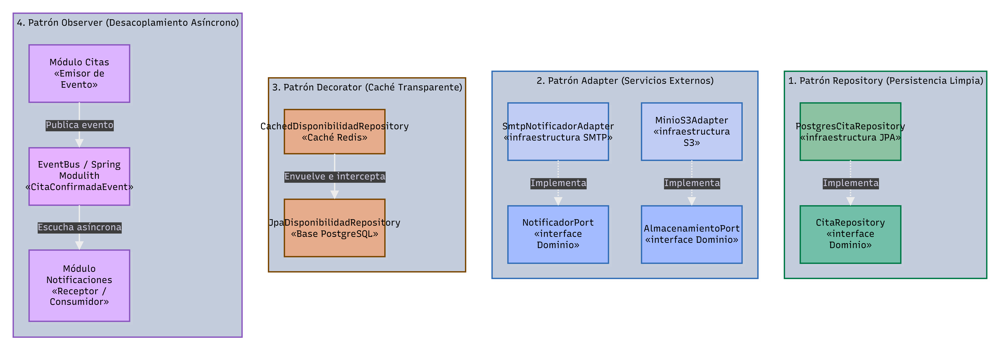

# Patrones de diseño

## Objetivo

Documentar los patrones de diseño aplicados en el backend del sistema HRA, indicando dónde se usan, qué problema resuelven y con qué tecnología se implementan, para que el equipo programe de forma uniforme.

## Contexto

- **Estilo:** monolito modular (Java + Spring Boot + Spring Modulith o TypeScript + Express).
- **Enfoque interno:** Clean Architecture.
- **Base:** diagrama de componentes (C4 nivel 3).

## Patrones aplicados

```mermaid
flowchart TD

%% ====================================================
%% PATRÓN 1: ADAPTER (Aislamiento de Servicios Externos)
%% ====================================================
subgraph PATRON_ADAPTER["PATRÓN ADAPTER — INTEGRACIÓN CON NOTIFICACIONES Y RENIEC"]
    direction LR
    CasoUso["<b>ReservarCitaUseCase</b><br>(Cliente del Puerto)"]
    PortNotif["&laquo;interface&raquo;<br><b>NotificadorPort</b><br>+enviarConfirmacion(cita): void"]
    AdapterEmail["<b>EmailNotificadorAdapter</b><br>+enviarConfirmacion(cita): void"]
    AdapterSMS["<b>SmsNotificadorAdapter</b><br>+enviarConfirmacion(cita): void"]
    ServicioSMTP["<b>Servidor SMTP Externo</b><br>(Librería de Transporte)"]
    GatewaySMS["<b>API Twilio / SMS</b><br>(Proveedor Telefónico)"]

    CasoUso -->|"usa puerto"| PortNotif
    AdapterEmail -.->|"implementa"| PortNotif
    AdapterSMS -.->|"implementa"| PortNotif
    AdapterEmail -->|"traduce llamada"| ServicioSMTP
    AdapterSMS -->|"traduce llamada"| GatewaySMS
end

%% ====================================================
%% PATRÓN 2: OBSERVER (Desacoplamiento Basado en Eventos)
%% ====================================================
subgraph PATRON_OBSERVER["PATRÓN OBSERVER — EVENTOS DE DOMINIO EN MEMORIA"]
    direction LR
    SubjectCitas["<b>Módulo Citas</b><br>(Subject / Emisor)<br>Confirma reserva de turno"]
    Evento["<b>CitaConfirmadaEvent</b><br>(Payload inmutable)"]
    ObsNotif["<b>NotificadorObserver</b><br>(Módulo Notificaciones)<br>Despacha correo al paciente"]
    ObsAudit["<b>AuditoriaObserver</b><br>(Módulo Auditoría)<br>Registra pista inmutable"]

    SubjectCitas -->|"publica en EventBus"| Evento
    Evento -.->|"notifica asíncronamente"| ObsNotif
    Evento -.->|"notifica asíncronamente"| ObsAudit
end

%% ====================================================
%% PATRÓN 3: STRATEGY (Cálculo Dinámico de Turnos Médicos)
%% ====================================================
subgraph PATRON_STRATEGY["PATRÓN STRATEGY — CÁLCULO Y ASIGNACIÓN DE CUPOS"]
    direction LR
    Contexto["<b>ValidadorCupoService</b><br>(Contexto de Reglas)"]
    StrategyInter["&laquo;interface&raquo;<br><b>ICalculoTurnoStrategy</b><br>+calcularDuracion(): int<br>+validarRequisitos(): boolean"]
    StratPresencial["<b>ConsultaPresencialStrategy</b><br>Duración: 20 min base"]
    StratTelemed["<b>TelemedicinaStrategy</b><br>Duración: 15 min + enlace"]
    StratProcedimiento["<b>ProcedimientoEspecialStrategy</b><br>Duración: 45 min + triaje"]

    Contexto -->|"delega cálculo a"| StrategyInter
    StratPresencial -.->|"implementa"| StrategyInter
    StratTelemed -.->|"implementa"| StrategyInter
    StratProcedimiento -.->|"implementa"| StrategyInter
end

style PATRON_ADAPTER fill:#0f172a,stroke:#38bdf8,stroke-width:2px,color:#fff
style PATRON_OBSERVER fill:#064e3b,stroke:#34d399,stroke-width:2px,color:#fff
style PATRON_STRATEGY fill:#1e1b4b,stroke:#818cf8,stroke-width:2px,color:#fff

style CasoUso fill:#1e293b,stroke:#38bdf8,color:#fff
style PortNotif fill:#0369a1,stroke:#7dd3fc,color:#fff
style AdapterEmail fill:#0f766e,stroke:#5eead4,color:#fff
style AdapterSMS fill:#0f766e,stroke:#5eead4,color:#fff
style ServicioSMTP fill:#78350f,stroke:#fde68a,color:#fff
style GatewaySMS fill:#78350f,stroke:#fde68a,color:#fff

style SubjectCitas fill:#065f46,stroke:#6ee7b7,color:#fff
style Evento fill:#047857,stroke:#a7f3d0,stroke-width:2px,color:#fff
style ObsNotif fill:#312e81,stroke:#a5b4fc,color:#fff
style ObsAudit fill:#312e81,stroke:#a5b4fc,color:#fff

style Contexto fill:#1e293b,stroke:#818cf8,color:#fff
style StrategyInter fill:#4338ca,stroke:#c7d2fe,color:#fff
style StratPresencial fill:#3730a3,stroke:#a5b4fc,color:#fff
style StratTelemed fill:#3730a3,stroke:#a5b4fc,color:#fff
style StratProcedimiento fill:#3730a3,stroke:#a5b4fc,color:#fff
```

| Patrón | Dónde se usa | Problema que resuelve | Se implementa con | Clases en el código |
|---|---|---|---|---|
| Repository | Todos los módulos → Base de datos | El negocio no debe conocer SQL ni JPA | Spring Data JPA / PostgreSQL | `CitaRepository` (interfaz dominio), `JpaCitaRepository` (infraestructura) |
| Adapter | Notificaciones → Servicio de correo | El servicio de correo tiene su propia API | JavaMailSender o API REST del proveedor | `NotificadorPort` (dominio), `EmailNotificadorAdapter` (infraestructura) |
| Adapter | Laboratorio/Imágenes → Almacenamiento S3 | El proveedor de almacenamiento tiene su propia API | SDK S3 compatible | `AlmacenamientoPort` (dominio), `S3AlmacenamientoAdapter` (infraestructura) |
| Decorator | Citas → Caché | Consultar disponibilidad más rápido sin modificar el repositorio | Redis (si se justifica con perfilamiento) | `CachedDisponibilidadRepository` envuelve `JpaDisponibilidadRepository` |
| Observer | Citas → Notificaciones | Notificar al paciente sin acoplar el módulo de citas al de notificaciones | Eventos Spring Modulith / EventBus | `CitaConfirmadaEvent` publicado por Citas, consumido por Notificaciones |

## Cómo funciona cada patrón

| Patrón | En pocas palabras |
|---|---|
| Repository | El negocio dice `guardar(cita)`; el repositorio escribe con JPA/SQL. |
| Adapter | El sistema dice `enviarConfirmacion(cita)` y el adaptador lo convierte en la llamada propia del servicio de correo o de S3. |
| Decorator | Busca primero en Redis; si no está, consulta PostgreSQL y lo guarda en Redis para la próxima vez. |
| Observer | Cuando se confirma una cita, se publica un evento. El módulo de Notificaciones lo escucha y envía el correo. Si falla, el evento se persiste para reintento. |

## Beneficio

- Cambiar el proveedor de correo, el almacenamiento S3 o la base de datos solo afecta al adaptador o al repositorio.
- La caché con Redis se puede activar o retirar sin tocar las reglas de negocio.
- Las notificaciones se pueden procesar en un worker separado sin modificar el flujo de reserva de citas.

## Patrones previstos para siguientes iteraciones

| Patrón | Dónde se aplicaría | Cuándo |
|---|---|---|
| Factory | Creación de diferentes tipos de estudio diagnóstico | Si los tipos de estudio se diversifican más allá de laboratorio, radiografía, ecografía y tomografía. |
| Strategy | Validación de resultados según tipo de estudio | Si las reglas de validación difieren significativamente entre laboratorio e imágenes. |
| Facade | Comunicación entre módulos | Cuando los módulos crezcan y necesiten una única puerta de entrada simplificada. |
