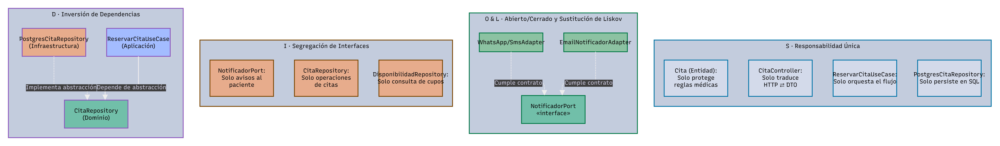
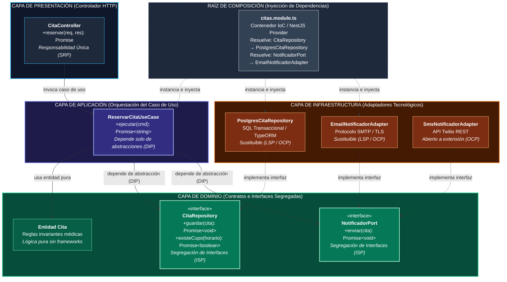

# Principios de diseño (SOLID)

## Objetivo

Documentar cómo se aplican los principios SOLID en el backend del sistema HRA, organizado con Clean Architecture, para que cada módulo se programe de forma uniforme y las reglas de negocio no dependan de la tecnología.

## Contexto

- **Estilo:** monolito modular (Java + Spring Boot + Spring Modulith o TypeScript + Express).
- **Enfoque interno:** Clean Architecture (presentación, aplicación, dominio, infraestructura).
- **Módulo de referencia:** Citas, porque concentra la concurrencia de reservas, la prevención de doble asignación y la integración con notificaciones.

## SOLID en el módulo Citas

| Principio | Dónde se aplica (capa) | Cómo se cumple en el sistema HRA | Clases |
|---|---|---|---|
| **S** · Responsabilidad única | Todas las capas | Cada clase tiene una sola tarea: el controlador recibe la petición HTTP, el caso de uso coordina la reserva, la entidad aplica las reglas de la cita y el repositorio guarda en PostgreSQL. | `CitaController`, `ReservarCitaUseCase`, `Cita`, `JpaCitaRepository` / `PostgresCitaRepository` |
| **O** · Abierto/cerrado | Infraestructura | Para agregar un nuevo canal de notificación (SMS, WhatsApp) se crea un nuevo adaptador; el caso de uso de reserva no se modifica. | `EmailNotificadorAdapter`, futuro `SmsNotificadorAdapter` |
| **L** · Sustitución de Liskov | Infraestructura | Email y un futuro SMS implementan `NotificadorPort` con el mismo contrato; el caso de uso funciona igual con cualquiera. | `EmailNotificadorAdapter`, futuro `SmsNotificadorAdapter` |
| **I** · Segregación de interfaces | Dominio | Cada interfaz tiene solo lo que el módulo necesita: `CitaRepository` solo guarda y busca citas, `NotificadorPort` solo envía avisos, `DisponibilidadRepository` solo consulta cupos. | `CitaRepository`, `NotificadorPort`, `DisponibilidadRepository` |
| **D** · Inversión de dependencias | Aplicación | El caso de uso recibe interfaces por el constructor y no conoce JPA, JavaMail ni PostgreSQL; las implementaciones se conectan en la configuración o contenedor IoC del módulo. | `ReservarCitaUseCase`, configuración del módulo Citas |

## Qué pasaría sin SOLID en el sistema HRA

| Situación real | Sin SOLID | Con SOLID |
|---|---|---|
| Se cambia el proveedor de correo | Hay que modificar el caso de uso de reserva | Solo se crea un nuevo adaptador |
| Se agrega almacenamiento S3 diferente | Se modifica el código del módulo Laboratorio | Solo se reemplaza `S3AlmacenamientoAdapter` |
| Se quiere probar la reserva de citas | Se necesita PostgreSQL y el servicio de correo real | Se prueba con implementaciones en memoria (fakes/mocks) |
| Cambia una regla de la cita (ej: tiempo mínimo de cancelación) | Hay que buscarla en controladores y servicios | Está solo en la entidad `Cita` |
| Se quiere verificar la integridad del cupo | Se necesita montar todo el sistema | Se prueba la entidad y el caso de uso aislados |

## Relación con Clean Architecture y los patrones

| Principio | Lo cumple en el proyecto |
|---|---|
| Responsabilidad única | La separación en capas de Clean Architecture |
| Abierto/cerrado y Liskov | El patrón Adapter (notificaciones, almacenamiento) |
| Segregación de interfaces | Los puertos del dominio (`CitaRepository`, `NotificadorPort`, `AlmacenamientoPort`) |
| Inversión de dependencias | El patrón Repository y la regla de dependencia: las capas externas dependen del dominio |
