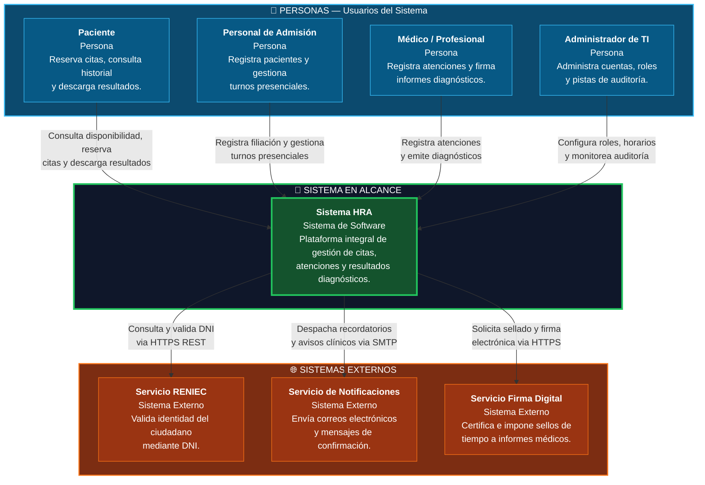
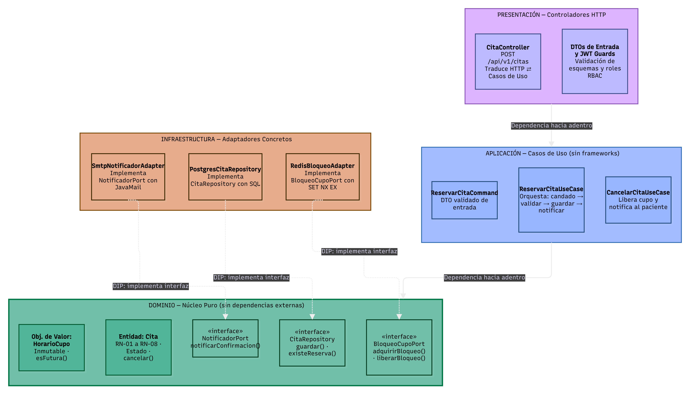

# Nivel 1 · Diagrama de contexto del sistema

> **Proyecto:** Sistema de Gestión Hospitalaria (HRA) – Hospital Regional Docente de Las Mercedes  
> **Modelo:** C4 · Nivel 1 de 4 · **Versión:** 1.0

---

## 1. Objetivo

Mostrar el **Sistema Hospitalario HRA como una sola caja**: quiénes interactúan con él (pacientes, personal médico, asistencial y administrativo) y con qué sistemas externos del ecosistema de salud estatal se comunica. Es la vista de mayor nivel y la primera que se presenta a directivos, auditores de salud y equipo técnico.

| Aspecto | Descripción |
|---|---|
| **Pregunta que responde** | ¿Qué es el sistema hospitalario HRA, quién lo usa y con qué servicios externos se integra? |
| **Audiencia** | Directores médicos, jefatura de estadística e informática, auditores de salud, equipo de desarrollo y operaciones |
| **Qué NO muestra** | Tecnologías de implementación, frameworks, servidores, bases de datos ni módulos internos |
| **Siguiente nivel** | `Nivel2-DiagramadeContenedores.md` |

---

## 2. Diagrama

<!-- imagen #07 — C4 Nivel 1: Diagrama de Contexto del Sistema HRA -->

> **Archivo editable:** `img/fuentes/nivel1-contexto.drawio`

---

## 3. Personas (usuarios)

| Persona | Descripción | Qué hace en el sistema |
|---|---|---|
| **Paciente** | Usuario asistencial que requiere atención médica | Consulta disponibilidad de turnos por especialidad, reserva citas ambulatorias, reprograma o cancela, y visualiza/descarga informes de laboratorio e imágenes. |
| **Personal de Admisión** | Personal administrativo de ventanilla y admisión hospitalaria | Valida la identidad y filiación del paciente, gestiona citas asignadas por ventanilla, emite fichas de atención y bloquea agendas por contingencias. |
| **Médico / Profesional** | Especialista asistencial en consultorios o servicios de diagnóstico | Consulta la lista de pacientes citados en el día, registra la evolución de la atención clínica, prescribe exámenes diagnósticos y emite diagnósticos con firma. |
| **Administrador de TI** | Encargado del soporte técnico y gobernanza del sistema | Gestiona el catálogo de consultorios y especialidades, asigna roles y permisos según el principio de menor privilegio, y supervisa las pistas de auditoría. |

---

## 4. Sistemas

| Sistema | Tipo | Responsabilidad | Quién lo construye / opera |
|---|---|---|---|
| **Sistema HRA** | Sistema en alcance | Automatiza el flujo asistencial de citas, atenciones y consulta de resultados para el Hospital Regional Docente Las Mercedes. | Equipo del proyecto |
| **Servicio RENIEC** | Sistema externo | Valida en línea la autenticidad del Documento Nacional de Identidad y extrae nombres y apellidos oficiales. | Registro Nacional de Identificación y Estado Civil |
| **Servicio Notificaciones** | Sistema externo | Envía avisos de citas por correo electrónico (SMTP institucional) o mensajería electrónica. | Proveedor de infraestructura de comunicaciones |
| **Servicio Firma Digital** | Sistema externo | Genera sellos criptográficos conformes a la normativa de firma digital para validez legal de informes médicos. | Plataforma de acreditación PKI / MINSA |

---

## 5. Relaciones

| Origen | Destino | Descripción | Protocolo |
|---|---|---|---|
| Paciente | Sistema HRA | Solicita citas, reprograma y consulta resultados diagnósticos | — (Interfaz Web) |
| Personal de Admisión | Sistema HRA | Registra pacientes presenciales y programa turnos en ventanilla | — (Interfaz Web) |
| Médico / Profesional | Sistema HRA | Registra evolución clínica y aprueba diagnósticos | — (Interfaz Web) |
| Administrador de TI | Sistema HRA | Administra catálogos hospitalarios, credenciales y monitorea logs | — (Interfaz Web) |
| Sistema HRA | RENIEC | Valida datos de identidad mediante consulta de DNI | HTTPS / REST |
| Sistema HRA | Servicio Notificaciones | Despacha alertas de citas confirmadas y resultados disponibles | HTTPS / REST / SMTP |
| Sistema HRA | Servicio Firma Digital | Solicita estampillado digital y firma de resultados médicos | HTTPS / REST |

> *Nota:* En el Nivel 1 no se detallan tecnologías internas de los canales de usuario; estas se desglosan en el Nivel 2.

---

## 6. Decisiones y supuestos

| # | Decisión o supuesto | Motivo |
|---|---|---|
| 1 | Las integraciones con servicios externos se realizan exclusivamente vía HTTPS/REST | Permite desacoplamiento total, protegiendo las bases de datos hospitalarias y cumpliendo estándares de interoperabilidad. |
| 2 | En caso de indisponibilidad temporal de RENIEC, el sistema permite registro asistido con validación manual diferida | Evita la interrupción de la atención de emergencia o admisión prioritaria ante caídas del servicio nacional. |
| 3 | El sistema no manipula datos de tarjetas de crédito o pasarelas financieras en esta fase inicial | Las atenciones se gestionan bajo el régimen de salud pública (SIS / copago en caja hospitalaria física). |
| 4 | Los sistemas externos no se modifican | Son servicios centralizados del estado o de proveedores consolidados; el Sistema HRA implementa adaptadores de integración. |

### Pendientes por definir

| Tema | Detalle |
|---|---|
| Integración con el Sistema de Información Hospitalaria nacional (SIS / FUA) | Evaluar la sincronización con el Formato Único de Atención digital del Seguro Integral de Salud en la fase 2. |
| Proveedor de mensajería móvil instantánea (WhatsApp API) | Evaluar costos y viabilidad para el envío de recordatorios automáticos 24 horas antes de la cita para reducir el ausentismo hospitalario. |
