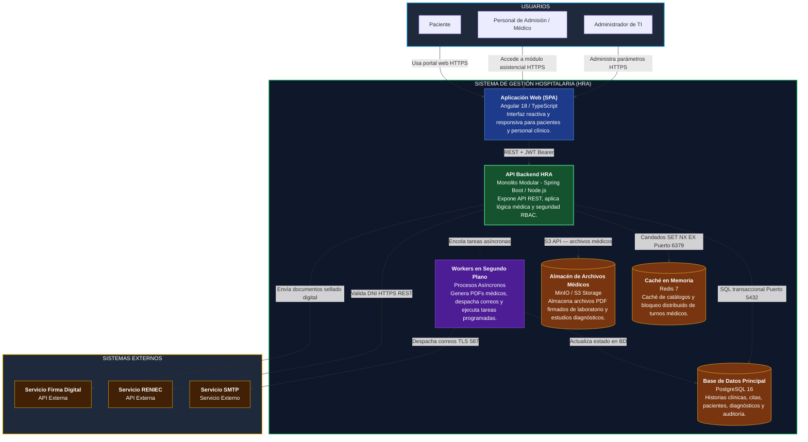
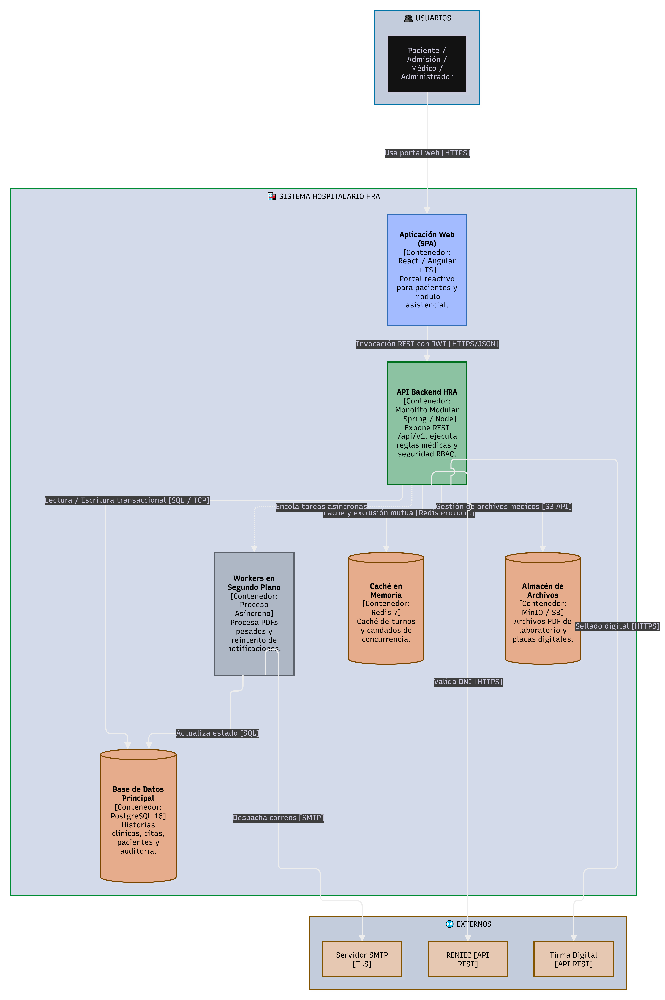

# Nivel 2 · Diagrama de contenedores

> **Proyecto:** Sistema de Gestión Hospitalaria (HRA) – Hospital Regional Docente de Las Mercedes  
> **Modelo:** C4 · Nivel 2 de 4 · **Versión:** 1.0

---

## 1. Objetivo

Abrir la caja «Sistema HRA» del Nivel 1 y mostrar los **contenedores ejecutables** que la componen: las aplicaciones frontend, servicios backend, almacenes de datos y mecanismos de procesamiento en segundo plano, detallando las tecnologías elegidas y cómo interactúan entre sí.

| Aspecto | Descripción |
|---|---|
| **Pregunta que responde** | ¿De qué piezas de software desplegables y almacenes de datos se compone el sistema y con qué tecnología opera? |
| **Audiencia** | Arquitectos de software, desarrolladores, ingenieros DevOps y administradores de infraestructura hospitalaria |
| **Qué es un contenedor** | Una unidad de software o almacenamiento de datos ejecutable por separado (por ejemplo, una SPA web, una API REST, un motor de base de datos relacional o una caché). No equivale necesariamente a un contenedor Docker |
| **Nivel anterior** | `Nivel1-DiagramadeContextodelSistema.md` |
| **Siguiente nivel** | `Nivel3-Diagrama-de-Componentes.md` |

---

## 2. Diagrama

<!-- imagen #08 — C4 Nivel 2: Diagrama de Contenedores del Sistema HRA -->

> **Archivo editable:** `img/fuentes/nivel2-contenedores.drawio`

---

## 3. Contenedores

| Contenedor | Tecnología | Responsabilidad | Datos que maneja |
|---|---|---|---|
| **Aplicación Web (SPA)** | React / Angular (TypeScript) + Vite | Provee la interfaz gráfica interactiva adaptada para pacientes (autoservicio) y para personal asistencial (consultorios, admisión). Se ejecuta en el navegador web del usuario. | Estado volátil de interfaz, formularios y token JWT en memoria de sesión. |
| **API Backend HRA** | Java 17 + Spring Boot (o TypeScript + Node.js) | Expone la API REST segura (`/api/v1`), ejecuta las reglas de negocio de los dominios hospitalarios, gestiona la seguridad RBAC y aplica Clean Architecture en un **monolito modular**. | Transitorios de procesamiento; delega persistencia a PostgreSQL y Redis. |
| **Workers en Segundo Plano** | Workers asíncronos desacoplados | Ejecuta procesos fuera del hilo de respuesta HTTP: generación pesada de reportes médicos en PDF, envío de notificaciones y recordatorios nocturnos. | Trabajos encolados y registros de reintentos de envíos. |
| **Base de Datos Principal** | PostgreSQL 16 | Almacén relacional con soporte transaccional robusto (ACID), integridad referencial e índices optimizados para historias clínicas. | Pacientes, profesionales, agendas, citas, evoluciones clínicas, diagnósticos y pistas de auditoría. |
| **Caché en Memoria** | Redis 7 | Almacena agendas médicas de alta frecuencia de consulta para acelerar búsquedas y gestiona semáforos de reserva concurrente de cupos. | Catálogo de especialidades, disponibilidad horaria en memoria y llaves de bloqueo distribuido. |
| **Almacén de Archivos Médicos** | MinIO / Almacenamiento S3 | Almacenamiento seguro de objetos y blobs médicos para evitar degradar el tamaño de la base de datos relacional. | Informes de laboratorio en PDF, resultados digitalizados y documentos clínicos sellados. |

---

## 4. Relaciones entre contenedores

| Origen | Destino | Descripción | Protocolo |
|---|---|---|---|
| Paciente / Médico / Personal | Aplicación Web (SPA) | Navegación e interacción desde exploradores web | HTTPS |
| Aplicación Web (SPA) | API Backend HRA | Invocación de casos de uso mediante servicios REST | HTTPS / JSON |
| API Backend HRA | Base de Datos Principal | Consultas y persistencia transaccional con ORM/JPA | SQL sobre TCP (Puerto 5432) |
| API Backend HRA | Caché en Memoria (Redis) | Lectura rápida de turnos y candados de concurrencia | Protocolo RESP sobre TCP (Puerto 6379) |
| API Backend HRA | Almacén de Archivos (MinIO) | Subida y enlace seguro de documentos clínicos | HTTPS / S3 API |
| API Backend HRA | Workers en Segundo Plano | Delegación de tareas asíncronas no bloqueantes | Mensajería / Tareas en base de datos |
| Workers | Servicio SMTP | Despacho de notificaciones y confirmaciones | SMTP / TLS (Puerto 587) |
| API Backend HRA | RENIEC | Validación de documento de identidad | HTTPS / REST |
| API Backend HRA | Servicio Firma Digital | Solicitud de sellado digital criptográfico | HTTPS / REST |

---

## 5. Decisiones arquitectónicas reflejadas

| Decisión | Alternativa descartada | Motivo |
|---|---|---|
| **Monolito modular con workers** | Microservicios distribuidos | El tamaño del equipo y la infraestructura hospitalaria regional aconsejan evitar la complejidad operativa de despliegues distribuidos, manteniendo la modularidad estricta en código. |
| **SPA desacoplada de API REST** | Arquitectura monolítica MVC generada en servidor | Permite evolucionar el portal de pacientes para aplicaciones móviles en el futuro sin modificar la lógica de negocio del backend. |
| **PostgreSQL para datos asistenciales** | Bases de datos documentales NoSQL | La confidencialidad y consistencia de las historias clínicas y asignación única de citas exigen garantías transaccionales ACID estrictas. |
| **Almacén de objetos MinIO/S3 para PDFs** | Almacenamiento BLOB dentro de la base de datos PostgreSQL | Guardar archivos médicos en la base de datos deteriora el tamaño de los backups y el rendimiento de las tablas transaccionales. |
| **Redis para agendas y concurrencia** | Bloqueo pesimista exclusivo a nivel de tabla en BD | Reduce drásticamente la contención y el tiempo de respuesta a menos de 1.5 segundos ante picos de demanda en apertura de turnos. |

---

## 6. Seguridad entre contenedores

| Canal de comunicación | Medida de protección |
|---|---|
| Navegador → Aplicación Web y API | Encriptación estricta de canal con HTTPS / TLS 1.3 y cabeceras HSTS. |
| Aplicación Web → API Backend | Autenticación stateless mediante tokens JWT con firma HMAC-SHA256 y roles (RBAC). |
| API Backend → Base de datos y Caché | Aislamiento en subred privada interna sin exposición pública; credenciales inyectadas mediante variables de entorno seguras. |
| Almacenamiento MinIO → Usuarios | Descargas de resultados mediante URLs prefirmadas de corta duración (vigencia de 15 minutos). |
| API → Sistemas externos | Almacenamiento seguro de llaves de API institucionales solo en variables del servidor. |
