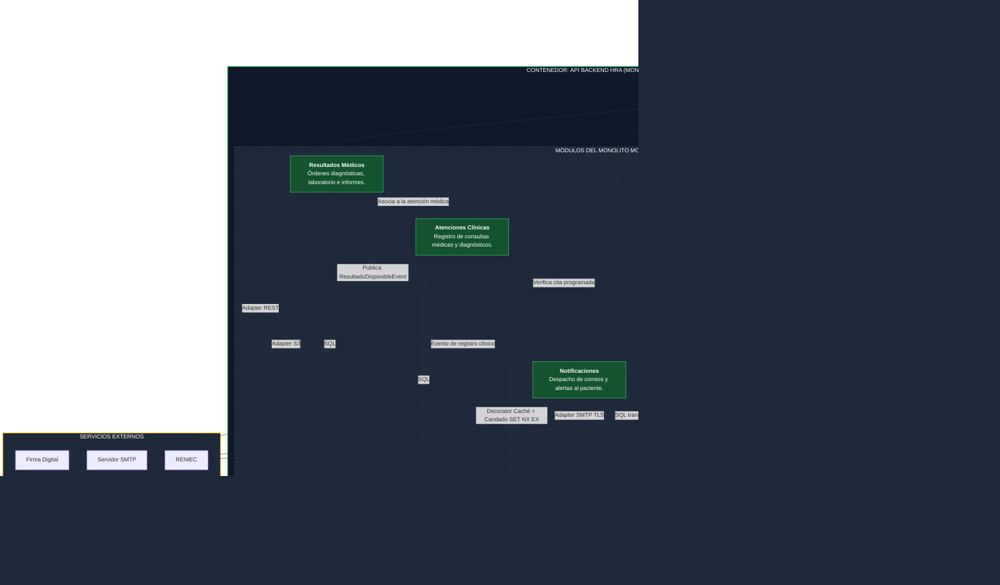

# Nivel 3 · Diagrama de componentes

> **Proyecto:** Sistema de Gestión Hospitalaria (HRA) · **Contenedor detallado:** API Backend HRA  
> **Modelo:** C4 · Nivel 3 de 4 · **Versión:** 1.0

---

## 1. Objetivo

Abrir el contenedor **API Backend HRA** del Nivel 2 y mostrar sus **componentes internos**: los módulos que conforman el monolito modular, la responsabilidad delimitada de cada uno, sus límites de dominio y cómo se comunican entre sí y con los almacenes de datos y servicios externos.

| Aspecto | Descripción |
|---|---|
| **Pregunta que responde** | ¿Cómo se estructura internamente el backend hospitalario y qué función cumple cada módulo? |
| **Audiencia** | Arquitectos de software y equipo de desarrollo backend |
| **Qué es un componente** | Una unidad lógica de software que agrupa funcionalidades cohesivas y expone una interfaz pública explícita. En la arquitectura HRA, cada **módulo funcional** del monolito modular constituye un componente |
| **Nivel anterior** | `Nivel2-DiagramadeContenedores.md` |
| **Siguiente nivel** | `Nivel4-DiagramadeCodigo.md` |

---

## 2. Diagrama

<!-- imagen #09 — C4 Nivel 3: Diagrama de Componentes del Backend HRA -->

> **Archivo editable:** `img/fuentes/nivel3-componentes.drawio`

---

## 3. Componentes

| Componente | Responsabilidad | Funcionalidades principales | Paquete en el código |
|---|---|---|---|
| **API REST Entrypoint** | Punto de entrada unificado HTTP del contenedor | Enrutamiento `/api/v1`, validación sintáctica de DTOs, autenticación JWT y filtro de excepciones global. | `src/api/` |
| **Usuarios y Acceso** | Gestión de identidad y control de acceso | Autenticación, asignación de roles (Paciente, Admisión, Médico, Administrador) y emisión de tokens. | `src/modules/usuarios/` |
| **Pacientes** | Filiación e identidad de usuarios de salud | Registro de pacientes, validación de DNI ante RENIEC y vinculación con la Historia Clínica. | `src/modules/pacientes/` |
| **Citas Médicas** | Planificación y gestión de turnos asistenciales | Catálogo de especialidades, programación de agendas, reserva concurrente y control de estados de citas. | `src/modules/citas/` |
| **Atenciones Clínicas** | Registro del acto médico | Gestión de consultas del médico, anamnesis, diagnóstico presuntivo y prescripción clínica. | `src/modules/atenciones/` |
| **Diagnósticos y Resultados** | Apoyo al diagnóstico y laboratorio | Generación de órdenes de exámenes, carga de resultados de laboratorio e imágenes y sellado digital. | `src/modules/diagnosticos/` |
| **Notificaciones** | Comunicación automatizada hacia los usuarios | Envío de correos de confirmación de reserva, recordatorios y alertas de resultados listos para descarga. | `src/modules/notificaciones/` |
| **Auditoría y Trazabilidad** | Registro forense de operaciones sensibles | Almacenamiento inmutable de eventos de acceso a historias clínicas y cancelaciones de citas. | `src/modules/auditoria/` |

---

## 4. Relaciones entre componentes

| Origen | Destino | Descripción | Tipo de comunicación |
|---|---|---|---|
| Aplicación Web (SPA) | API REST Entrypoint | Peticiones HTTP con payload JSON y encabezado `Authorization: Bearer` | HTTPS / JSON |
| API REST Entrypoint | Módulos de negocio | Despacha la llamada al caso de uso correspondiente | Llamada en memoria / Inyección de dependencias |
| Citas Médicas | Pacientes | Verifica la vigencia del paciente antes de confirmar el cupo | Invocación a la API pública del módulo (`index.ts`) |
| Atenciones Clínicas | Citas Médicas | Verifica que el paciente tenga una cita confirmada en el turno actual | Invocación en memoria vía API pública |
| Diagnósticos y Resultados | Atenciones Clínicas | Asocia la orden diagnóstica a la atención clínica de origen | Invocación en memoria vía API pública |
| Citas Médicas | Notificaciones | Notifica la reserva o reprogramación de cita | Evento asíncrono en memoria (`CitaConfirmadaEvent`) |
| Diagnósticos y Resultados | Notificaciones | Notifica que un informe de laboratorio está disponible | Evento asíncrono en memoria (`ResultadoDisponibleEvent`) |
| Todos los módulos | Auditoría | Registra acciones clínicas críticas de lectura o modificación | Eventos de dominio persistidos de forma inmutable |

---

## 5. Relaciones con contenedores y sistemas externos

| Componente | Destino | Descripción | Protocolo | Patrón aplicado |
|---|---|---|---|---|
| Todos los módulos | Base de Datos (PostgreSQL) | Cada módulo gestiona y persiste **únicamente sus propias tablas** | SQL transaccional | **Repository** |
| Citas Médicas | Caché (Redis) | Consulta disponibilidad de turnos y aplica candados de reserva distribuida | TCP / Redis Protocol | **Decorator** |
| Diagnósticos y Resultados | Almacén de Archivos (MinIO) | Sube y lee informes en PDF y placas radiológicas | HTTPS / S3 API | **Adapter** |
| Pacientes | Servicio RENIEC | Valida el número de DNI y recupera datos de identidad | HTTPS / REST | **Adapter** |
| Notificaciones | Servidor SMTP / Correo | Despacha correos electrónicos con confirmaciones y alertas | SMTP / TLS | **Adapter** |
| Diagnósticos y Resultados | Servicio Firma Digital | Solicita estampillado digital para el informe médico | HTTPS / REST | **Adapter** |

---

## 6. Reglas del monolito modular

| # | Regla | Motivo de diseño |
|---|---|---|
| 1 | **Despliegue unificado:** Todos los componentes se empaquetan y ejecutan juntos en un único contenedor de backend. | Simplifica la operación hospitalaria, evitando sobrecostos de infraestructura y orquestación distribuida innecesaria. |
| 2 | **Encapsulamiento por módulo:** Un módulo solo puede interactuar con otro mediante la interfaz pública exportada (`index.ts` o interfaz pública de servicio). | Prohíbe que dependencias internas de un módulo filtren detalles de implementación hacia otros módulos. |
| 3 | **Aislamiento estricto de tablas:** Ningún módulo puede consultar (`SELECT`) ni modificar (`INSERT/UPDATE`) tablas que pertenezcan al esquema de otro módulo. | Mantiene la independencia de datos, permitiendo extraer un módulo a microservicio en el futuro sin refactorizar la base de datos. |
| 4 | **Aislamiento de sistemas externos:** Cada integración externa (RENIEC, Correo, Firma) se encapsula en un único adaptador dentro de su módulo respectivo. | Si el proveedor estatal o el servicio de correo cambia de API, solo se actualiza una clase sin afectar el negocio. |
| 5 | **Clean Architecture interna:** Cada módulo se organiza internamente en cuatro capas concéntricas (Dominio, Aplicación, Infraestructura, Presentación). | Garantiza que las reglas de salud no dependan de frameworks web, librerías ORM ni bases de datos. |
