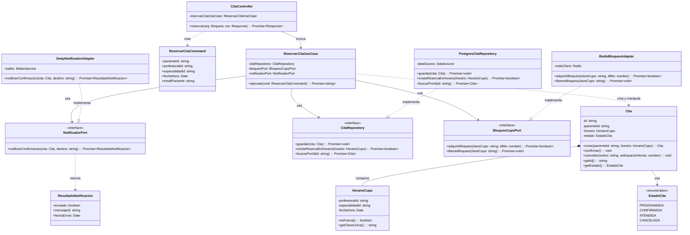
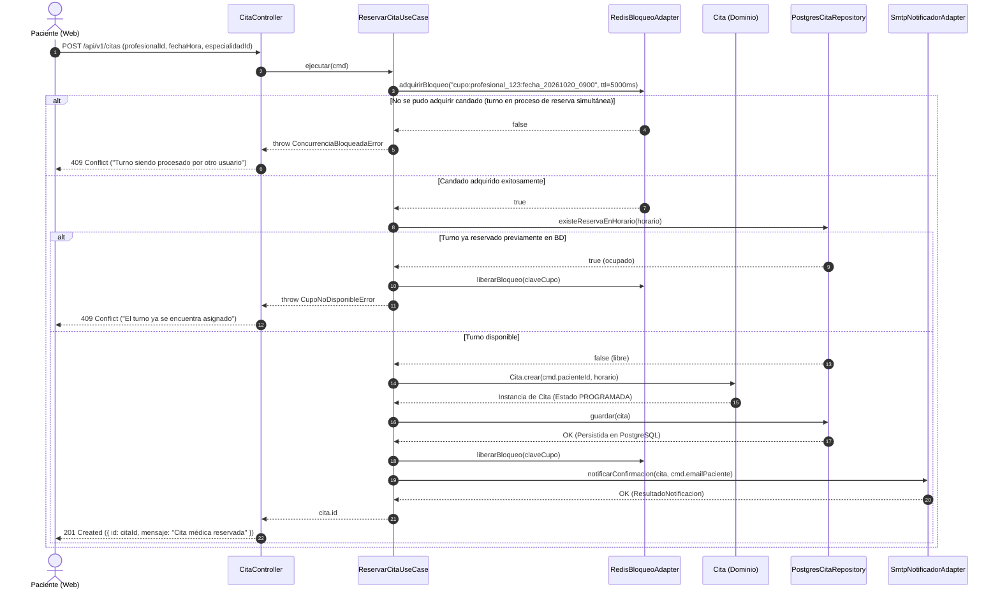

# Nivel 4 · Diagrama de código

> **Proyecto:** Sistema de Gestión Hospitalaria (HRA) · **Módulos detallados:** Citas Médicas y Notificaciones  
> **Modelo:** C4 · Nivel 4 de 4 · **Notación:** UML · **Versión:** 1.0

---

## 1. Objetivo

Mostrar **cómo está estructurado el código fuente** de los componentes del Nivel 3: sus clases concretas, interfaces, tipos y la colaboración entre ellas. Se detalla el flujo crítico del sistema hospitalario: **Reserva de cita médica ambulatoria con control de concurrencia y notificación al paciente**.

| Aspecto | Descripción |
|---|---|
| **Pregunta que responde** | ¿Qué clases e interfaces componen el módulo por dentro y cómo colaboran respetando Clean Architecture? |
| **Audiencia** | Desarrolladores de software y evaluadores técnicos de arquitectura |
| **Notación** | UML estándar (Diagrama de clases y diagrama de secuencia), recomendado por el Modelo C4 para el nivel de código |
| **Por qué estos módulos** | En el modelo C4, el Nivel 4 es selectivo. Se enfoca en **Citas Médicas** y **Notificaciones**, dado que representan el núcleo transaccional, el mayor riesgo de concurrencia (evitar doble reserva de un cupo) y la comunicación desacoplada |
| **Nivel anterior** | `Nivel3-Diagrama-de-Componentes.md` |

---

## 2. Diagrama de clases

<!-- imagen #10 — C4 Nivel 4: Diagrama UML de Clases — Módulos Citas y Notificaciones -->

> **Archivo editable:** `img/fuentes/nivel4-clases.svg`

### 2.1 Capas de Clean Architecture

| Capa | Contiene | Regla arquitectónica |
|---|---|---|
| **Presentación** | Controladores (`CitaController`), Rutas | Traduce la petición HTTP a comandos de aplicación y devuelve respuestas JSON con los códigos de estado correspondientes (201, 400, 409). |
| **Aplicación** | Casos de uso (`ReservarCitaUseCase`), Comandos DTO | Coordina el flujo: controla el candado distribuido, consulta disponibilidad, invoca a la entidad de dominio y persiste la cita. No conoce librerías de infraestructura. |
| **Dominio** | Entidad `Cita`, Objeto de Valor `HorarioCupo`, Enumeraciones, Puertos/Interfaces | Alberga la lógica médica invariable (RN-01 a RN-05). No importa nada externo al propio dominio. |
| **Infraestructura** | Repositorios (`PostgresCitaRepository`), Adaptadores (`RedisBloqueoAdapter`, `SmtpNotificadorAdapter`) | Implementa los contratos definidos en el dominio mediante tecnologías concretas (PostgreSQL, Redis, SMTP). |

> **Regla de dependencia:** Las dependencias apuntan exclusivamente hacia el centro (**Dominio**). Las clases de infraestructura implementan interfaces del dominio mediante el principio de inversión de dependencias; el dominio jamás conoce a la infraestructura.

---

### 2.2 Clases del módulo Citas Médicas

| Clase | Tipo | Capa | Responsabilidad |
|---|---|---|---|
| `CitaController` | Controlador | Presentación | Recibe `POST /api/v1/citas`, extrae la identidad del paciente del token JWT y delega la ejecución al caso de uso. |
| `ReservarCitaUseCase` | Caso de uso | Aplicación | Orquesta la reserva: valida exclusión concurrente, verifica disponibilidad, crea la cita en dominio, persiste y solicita notificación. |
| `ReservarCitaCommand` | Objeto DTO | Aplicación | Encapsula los parámetros validados requeridos para ejecutar la reserva. |
| `Cita` | Entidad raíz | Dominio | Controla las reglas invariantes de la cita: asignación de paciente, control de estados válidos y restricciones de cancelación. |
| `HorarioCupo` | Objeto de valor | Dominio | Representa el turno: médico, especialidad y horario. Es inmutable y valida que el cupo no sea en el pasado. |
| `EstadoCita` | Enumeración | Dominio | Estados del ciclo de vida: `PROGRAMADA`, `CONFIRMADA`, `ATENDIDA`, `CANCELADA`. |
| `CitaRepository` | Interfaz (Puerto) | Dominio | Contrato que define las operaciones para guardar y buscar citas médicas. |
| `BloqueoCupoPort` | Interfaz (Puerto) | Dominio | Contrato para garantizar exclusión mutua de reserva durante la selección del turno. |
| `PostgresCitaRepository` | Repositorio | Infraestructura | Implementa `CitaRepository` contra la base de datos PostgreSQL utilizando transacciones. |
| `RedisBloqueoAdapter` | Adaptador | Infraestructura | Implementa `BloqueoCupoPort` mediante comandos atómicos `SET NX EX` de Redis. |

---

### 2.3 Clases del módulo Notificaciones

| Clase | Tipo | Capa | Responsabilidad |
|---|---|---|---|
| `NotificadorPort` | Interfaz (Puerto) | Dominio | Contrato desacoplado que define el método para despachar la confirmación de la cita médica. |
| `ResultadoNotificacion` | Objeto DTO | Dominio | Información de confirmación del despacho (identificador de mensaje y estampa temporal). |
| `SmtpNotificadorAdapter` | Adaptador | Infraestructura | Implementa `NotificadorPort` conectándose a un servidor SMTP o proveedor de correo institucional. |

---

### 2.4 Notación UML utilizada

| Símbolo | Significado | Ejemplo en el diagrama |
|---|---|---|
| Línea continua con flecha (`-->`) | **Asociación:** La clase mantiene una referencia directa a la otra clase | `ReservarCitaUseCase` → `CitaRepository` |
| Línea discontinua con flecha (`..>`) | **Dependencia:** Una clase crea o recibe como parámetro a otra sin almacenarla | `CitaController` ..> `ReservarCitaCommand` |
| Línea discontinua con triángulo hueco (`..|>`) | **Realización / Implementación:** Una clase implementa una interfaz | `PostgresCitaRepository` ..\|> `CitaRepository` |
| Rombo relleno (`*--`) | **Composición:** El objeto hijo no tiene sentido ni existencia fuera del agregado raíz | `Cita` *-- `HorarioCupo` |
| `<<interface>>` | **Interfaz:** Declaración formal de contrato sin código de infraestructura | `CitaRepository`, `NotificadorPort` |
| `-` y `+` | **Visibilidad:** Atributo/método privado (`-`) o público (`+`) | `- estado`, `+ confirmar()` |

---

## 3. Diagrama de secuencia: reservar cita médica

<!-- imagen #11 — C4 Nivel 4: Diagrama de Secuencia — Reservar Cita con Control de Concurrencia -->

> **Archivo editable:** `img/fuentes/nivel4-secuencia.svg`

### 3.1 Detalle de pasos del flujo

| Paso | Origen → Destino | Acción realizada | Capa |
|---|---|---|---|
| 1 | Paciente Web → `CitaController` | Envía petición HTTP `POST /api/v1/citas` con el token JWT en el encabezado. | Presentación |
| 2 | `CitaController` → `ReservarCitaUseCase` | Instancia el comando validado `ReservarCitaCommand` e invoca `ejecutar(cmd)`. | Presentación → Aplicación |
| 3 | `ReservarCitaUseCase` → `RedisBloqueoAdapter` | Adquiere candado atómico en Redis (`SET NX EX`) para prevenir condiciones de carrera. | Aplicación → Infraestructura |
| 4 | `ReservarCitaUseCase` → `PostgresCitaRepository` | Consulta si el turno ya fue registrado en la base de datos (`existeReservaEnHorario`). | Aplicación → Infraestructura |
| 5 | `ReservarCitaUseCase` → `Cita` | Invoca factory method `Cita.crear(pacienteId, horario)` validando reglas de negocio. | Aplicación → Dominio |
| 6 | `ReservarCitaUseCase` → `PostgresCitaRepository` | Persiste la nueva entidad en PostgreSQL dentro de una transacción. | Aplicación → Infraestructura |
| 7 | `ReservarCitaUseCase` → `RedisBloqueoAdapter` | Libera el candado del turno tras asegurar la persistencia. | Aplicación → Infraestructura |
| 8 | `ReservarCitaUseCase` → `SmtpNotificadorAdapter` | Despacha la confirmación por correo electrónico sin bloquear la base de datos. | Aplicación → Infraestructura |
| 9 | `CitaController` → Paciente Web | Retorna respuesta HTTP `201 Created` con el identificador único de la cita. | Presentación |
| Alternativa | Control de errores | Si el cupo está bloqueado o tomado, devuelve código HTTP `409 Conflict` de inmediato. | Aplicación → Presentación |

---

## 4. Patrones y principios que se evidencian en este nivel

| Elemento del diagrama | Patrón o Principio de diseño | Justificación técnica en el sistema HRA |
|---|---|---|
| `SmtpNotificadorAdapter`, `RedisBloqueoAdapter` | Patrón **Adapter** | Aíslan los SDKs de terceros (cliente Redis y librerías de correo) detrás de interfaces del dominio (`BloqueoCupoPort`, `NotificadorPort`). |
| `PostgresCitaRepository` | Patrón **Repository** | Desacopla la lógica de reserva de las sentencias SQL o del ORM utilizado. |
| Inyección de dependencias en `ReservarCitaUseCase` | Principio de **Inversión de Dependencias (D)** | El caso de uso recibe abstracciones mediante su constructor, posibilitando pruebas unitarias con fakes en milisegundos sin levantar PostgreSQL ni Redis. |
| Separación entre `CitaController`, `ReservarCitaUseCase` y `Cita` | Principio de **Responsabilidad Única (S)** | El controlador maneja HTTP, el caso de uso coordina la orquestación y la entidad protege las invariantes médicas. |
| Posibilidad de incorporar `WhatsAppNotificadorAdapter` | Principio **Abierto/Cerrado (O)** | Se puede incorporar un nuevo canal de notificación creando un nuevo adaptador sin modificar una sola línea del caso de uso. |
